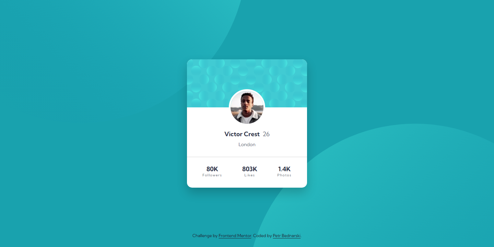
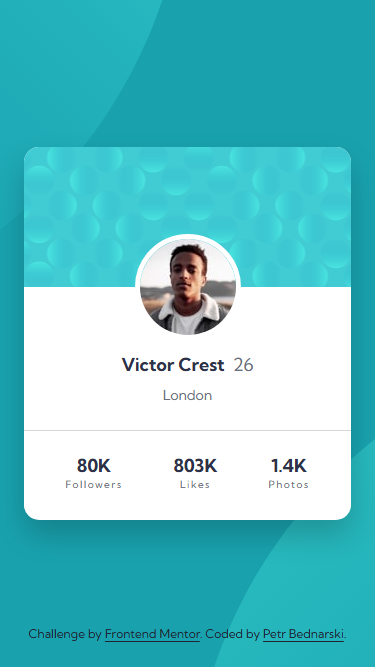

# Frontend Mentor - Profile card component

My first [Frontend Mentor](https://www.frontendmentor.io/) challenge: a responsive profile card built with HTML and CSS.

## Links

- [Source code](https://github.com/pettik/FrontendMentor--fe-profile-card-component)
- Hosting: the existing Netlify site.

## Solution screenshots

These screenshots show the implemented page, including the visible attribution.

## Built with

- Semantic HTML: a main landmark, a profile heading, and a list of statistics.
- CSS custom properties for the challenge colors.
- CSS Grid for page centering and Flexbox for the name and statistics.
- Layered CSS backgrounds for decorative patterns that do not affect page overflow or screen reader navigation.
- A fluid card width and a minimum viewport height, with natural scrolling on short screens.

## Run locally

Open `index.html` directly in a browser, for example by double-clicking the file. No terminal commands, local server, package installation, or build step are required.

The page uses plain HTML and CSS with local image files. The Kumbh Sans font loads from Google Fonts; a sans-serif fallback is available offline.

## Deployment on Netlify

Keep using the existing Netlify site. This repository is ready to serve as static files directly from its root directory:

| Setting | Value |
| --- | --- |
| Build command | Leave empty |
| Publish directory | `.` (repository root) |

There is no `package.json`, npm script, or generated output to build. `index.html`, `style.css`, and the images in `design/images/` are the deployable files. All local assets use relative paths, so they also work when opening `index.html` directly.

See the [Netlify build settings documentation](https://docs.netlify.com/build/configure-builds/overview/) for the build command and publish directory settings.

## Validation

The implementation was checked in Chrome at 320 x 568, 375 x 667, 390 x 844, 768 x 1024, 1440 x 720, 1440 x 1080, 667 x 375, and 320 x 320 pixels. All 90 checks passed, covering card centering, horizontal overflow, short-screen scrolling, 200% text sizing, keyboard focus, accessible headings and lists, and asset loading under the repository subdirectory.

## What I learned

A fixed page height and a large top margin only align the card at one viewport size. A grid with `min-height: 100svh` and flexible rows centers the card when space is available and lets the document grow when the screen is short. Moving purely decorative images into CSS also keeps them out of the accessibility tree and prevents them from creating scrollbars.

## Next steps

Explore self-hosting Kumbh Sans to remove the external font request and keep typography consistent offline.

## Commit messages

Use a short subject that describes the change, for example `Fix responsive profile card layout` or `Document the completed solution`. Add a body when the reason or validation needs more explanation.
